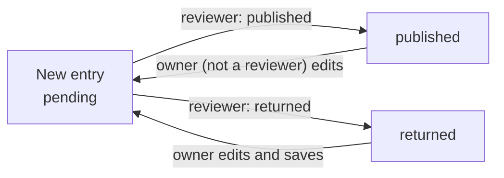

# Echoes of Khmer New Year — a Khmer Living Archive

**Curator:** Chheav Kimheng · ICT 340 — Vibe Coding, American University of Phnom Penh, Fall 2026
**Live site:** https://my-hometown-archive.vercel.app

## 1. What this is

Echoes of Khmer New Year is a living archive of the customs, rituals, games and food of Choul Chnam Thmey, the Khmer New Year, as my family keeps them each year at my grandparents' house in Kandal Province. The knowledge comes from my mother and my family, learned by watching, helping and asking questions, not from books. Visitors can browse and search nine published entries in Khmer or English, read the story behind the archive on the About page, sign up, and add entries of their own with a photo. Every contribution is read by a reviewer before it is published. I built it over three sprints in ICT 340.

## 2. Who it's for

The people who would use this archive are my family, other Khmer families who want to write down what they keep, and Khmer speakers who want to read it in their own language, mostly on phones.

**Khmer first**
- A flag button in the header switches the whole interface between English and Khmer: menu, buttons, form labels and error messages, status words, and the Home and About pages.
- The first eight entries have their Khmer text in `data/translations.js`. New entries carry their own Khmer title and description (`title_km`, `description_km`).
- In the contribution form the Khmer fields are required and checked. The text must contain Khmer script (Unicode U+1780–U+17FF) and be mostly Khmer, so English typed into a Khmer box is refused. The English fields are optional. If someone writes only Khmer, it is also saved as the main title and description, so a contributor without English can still add an entry.
- No field asks for a first and a last name. The contributor and source fields are free text and accept Khmer script and a single name.

**Phones first**
- My phone test on an iPhone showed the header links and email running off the screen. I replaced the header links with a menu button that opens a slide-in drawer.
- Grids collapse to one column on small screens, and form inputs are 16 px so iPhones do not zoom in when you tap them.

**Slow connections**
- There are no web fonts to download. The site uses the fonts already on the device.
- Pages show gray loading placeholders while entries load. The home slideshow photos go through `next/image`, which serves each screen a resized copy. Uploaded photos must be JPEG, PNG or WebP and up to 5 MB.

**How sources are named and credited**
- Every new entry must name who shared the knowledge (the `source` field) and who is credited (`contributor`). The About page names the curator and the source of the whole archive, and section 6 credits every photo.

**What I changed because of who the users are**
- My Context Audit found the contribution form was English only while the rest of the site switched to Khmer. I translated the form and its errors and made the Khmer fields the required ones.
- "Add entry" and "My Entries" were hidden when logged out, so a visitor could not tell that the archive accepts contributions. They are now always in the menu, and a logged-out visitor gets a sign-up or log-in prompt.
- A contributor who writes only Khmer is accepted, as described above.

**Known gaps**
- The Edit page heading and messages, the delete confirmation, and the Edit and Delete buttons on an entry are still English only.
- All Khmer interface text was drafted by AI. I read Khmer and reviewed it, but a second native speaker has not proofread it.
- A photo is required for every new entry, and a contributor needs an email address and an account. That keeps out someone with no photo to share.
- Uploaded photos are not compressed in the browser. The three home slideshow photos were 0.7–0.9 MB each when I measured them on Nov 18, which is heavy on mobile data.

## 3. How it works

- **Site:** Next.js 15 (App Router, React 19, JavaScript only) on Vercel.
- **Accounts, data and photos:** Supabase — Auth, a Postgres database protected by row-level security (RLS), and a public Storage bucket called `photos`.
- **Dependencies:** `next`, `react`, `react-dom`, `@supabase/ssr` and `@supabase/supabase-js`, and nothing else.
- **Where things live:** `app/` holds the pages (home, entries, entry, edit, contribute, my-entries, review, about, login, signup). `components/` holds the pieces they share. `data/translations.js` holds the English and Khmer text. `data/entryOptions.js` holds the lists of categories, festival days and tags. `utils/validateEntry.js` holds the form rules. `utils/supabase/` holds the browser and server clients. `supabase/` holds the SQL I ran, in order.

### Tables

**`entries`**

| Column | What it holds |
| :--- | :--- |
| `id`, `created_at` | Identity and submission time. The review queue sorts by `created_at`, oldest first. |
| `owner` | The account that submitted the entry. Set from the login session, never from the form. |
| `title`, `description` | The main text. It is English, or Khmer if that is all the contributor wrote. |
| `title_km`, `description_km` | The Khmer text. The first eight entries keep theirs in `data/translations.js`, matched by `slug`. |
| `contributor`, `place`, `source` | Who is credited, where it happened, and who shared the knowledge. |
| `category`, `festival_day`, `tags` | Ritual, food, game, song and music or other; day 1, 2, 3, before or any day; and keyword tags. The lists are enforced by check constraints. |
| `photo_url` | The photo's address. New photos live in the `photos` bucket under the owner's id. The first eight entries use local `/images` files. |
| `slug` | Links the first eight entries to their Khmer text in `data/translations.js`. |
| `status` | `pending`, `published` or `returned`, enforced by a check constraint. New rows start as `pending`. |

**`reviewers`** has one column, `user_id`. RLS is on and there are **no policies**, so nobody can read or write it through the API. Only the SQL Editor can change the list.

### The three statuses



- **pending** — waiting in the review queue. Only its owner and reviewers can see it.
- **published** — visible to everyone. If a contributor edits a published entry, it goes back to `pending` and disappears from the public pages until a reviewer looks again. Reviewers' own edits stay published.
- **returned** — sent back by a reviewer. The owner sees it on My Entries as "Returned for changes", and editing and saving puts it back in the queue.

### Policies on `entries`

| Policy | Rule |
| :--- | :--- |
| `anyone can read published entries` (select) | A row is visible if `status = 'published'`, or the viewer is its owner, or the viewer is a reviewer. |
| `owners add their own entries` (insert) | Only logged-in users, and only with `owner = auth.uid()` and `status = 'pending'`. |
| `owners edit their own entries` (update) | Only the owner, and the new status must be `pending` unless the editor is a reviewer. |
| `owners delete their own entries` (delete) | Only the owner. |

### Two database functions

- `is_reviewer()` answers yes or no: is the logged-in user on the `reviewers` list? It is `security definer` with an empty `search_path`, so it can read a table nobody else can.
- `review_entry(entry_id, decision)` is the only way a reviewer changes a status.

## 4. Security decisions

**The gate.** `review_entry` checks `is_reviewer()`, refuses any decision except `published` or `returned`, and updates only rows that are still `pending`. It returns `true` when it changed a row and `false` when it refused. Refusing is not an error, so my buttons count a click as a success only when the result is exactly `true`. Reviewers cannot update the `entries` table directly. They never get permission to edit someone else's entry, only this one narrow door that moves a status and nothing else. The function is `security definer`, execute permission is revoked from the public and from anonymous visitors, and it is granted only to logged-in users.

**It lives in the database because the page can be skipped.** Anyone can open the browser console and call the API without my pages. A rule in my code only protects people who use my code.

**What a hidden Publish button does and doesn't protect.** The Review link in the menu only shows for reviewers, and `/review` asks the server whether the visitor is a reviewer before it loads anything. That keeps the site tidy, and nothing more. If it were missing, a stranger would see an empty queue and every button would fail, because the database says no. The same goes for the `.eq('status', 'published')` filter on the public pages. The database already hides pending entries from logged-out visitors, but owners and reviewers can read their own and everyone's pending entries, so without the filter those would show on the public pages for the people logged in.

**Tests I ran** (second account as the stranger, browser console on the live site, Oct 25 2026):

| Attack | What came back |
| :--- | :--- |
| Insert an entry with status `published` | Error 42501, row-level security. No row created. |
| Update my own pending entry to `published` | Error 42501, row-level security. |
| Call `review_entry` as a non-reviewer | `data: false`, no error. |
| Insert myself into `reviewers` | Error 42501, permission denied for table `reviewers`. |
| Logged out, ask for anything not published | `data: []`. |

On Nov 1 I also opened `/review` as the stranger, which showed only the reviewers-only message, and confirmed that `review_entry` still returned `false`.

**A bug the tests didn't catch.** On review day, my partner found that pending entries showed on the Entries page. The published filter had never landed on that page. Logged-out visitors were never affected, but a logged-in owner or reviewer saw them. I fixed it on Nov 9.

**Decisions the briefs left to me**
- **What a returned entry says.** On My Entries it shows "Returned for changes" (and the Khmer equivalent) with an "Edit and resubmit" link. It does not say why. A reviewer's note would need a new column and a changed `review_entry`, and I did not build it. A returned contributor has to guess what to fix, and that is my biggest known gap in the review flow.
- **Whether reviewers can take down published entries.** They cannot, through the site. `review_entry` only touches pending entries. Taking an entry down means using the Supabase dashboard as the project owner. I kept the door narrow so a reviewer account that is hacked or careless can only approve or return new entries. The cost is that a mistake in a published entry needs me.
- **What search shows a contributor about their own pending entries.** Nothing. The public Entries page and its search load only published entries, for every visitor. A contributor sees their pending entries only on My Entries, with the status in plain words. This way the public pages look the same to everyone.
- **What an edit to a published entry does.** It goes back to pending. Otherwise a contributor could get a harmless entry approved and change it afterwards. The cost is that a small typo fix removes the entry from the archive until it is reviewed again.
- **Who is a reviewer.** Only accounts on the `reviewers` list, and only I can change that list, in the SQL Editor.

## 5. AI use

I used **Claude** in the Claude chat app for all AI-assisted code, and **Gemini** to generate the three home-page photos. I did not use Cline at any point. Claude cannot see my project, so for every change I pasted in the files it asked for and applied the edits by hand. Commits where AI wrote the code are marked `(AI-assisted)` in the git history.

| Sprint | Model | Task | What I kept, rewrote or rejected | How I checked it |
| :--- | :--- | :--- | :--- | :--- |
| 1 | Claude (chat; I did not record the exact model) | Browse and search from the static entries file, plus the Khmer and English layout. It drafted the Khmer text of the first eight entries. | Kept the structure. The Khmer text is still marked AI-drafted in `data/translations.js`. I read Khmer and reviewed it. | Ran the site and searched in both languages. |
| 2 | Claude (chat) | Entries table and four RLS policies, moving my eight entries into Supabase, and rewiring the pages to read from it. | Kept the policies exactly as written, since they were never the problem. Caught that its default `uuid` id would break every Khmer translation keyed by string id, so I added a `slug` column and backfilled it. It missed a table GRANT, so requests failed before the policies were checked. | Checked row counts after each script (my first run created 16 duplicate rows). Tested logged out from the console. |
| 2 | Claude (chat) | Sign up and log in, the contribution form with photo upload, and edit and delete of your own entries. | Kept. | Tried to edit another user's entry with a second account. |
| 3 | Claude Sonnet 5.5 (chat) | Lab 10, the gate: the status column and rules (the SQL block came from the lab, Claude only put my user id in), then the published filters, My Entries, the waiting message and edits going back to pending. | Pasted the code as written. The Entries page filter was missing and my partner found it. | Read the whole diff, then ran the five console attacks from a second account. |
| 3 | Claude Sonnet 5.5 | Lab 11, the review queue: `/review` with a server check, and Publish and Return buttons that call `review_entry`. | Pasted as written. | Four diff checks from the lab, then a round trip (publish, return, edit, resubmit) and the stranger test. |
| 3 | Claude Sonnet 5.5 | Fixes after review day: footer at the bottom of short pages, and the header menu. | My decisions: I chose the drawer over a drop-down, moved it from the left to the right, and changed boxed links to lines between them. | Looked at it in the browser and on my phone. |
| 3 | Claude Sonnet 5.5 | Redesign of the home, entries, My Entries, About, log-in and sign-up pages, and a richer contribution form (category, day, source, tags, Khmer fields). | I directed each redesign and changed what I did not like: the header photo's height and shape, the width of the search bar, and the Khmer validation (below). | Ran each page in both languages and at phone width. |
| 3 | Claude Sonnet 5.5 | Form validation for the Khmer fields. | Its first version only checked that the Khmer boxes were not empty. I tested typing English into them and a single letter, and both saved. I made it require Khmer script and added minimum and maximum lengths with counters. | Typed English, one-letter and mixed text into every field. |
| 3 | Gemini (with prompts written by Claude) | The three photos behind the home page title and the About page. | Kept all three. They are AI-generated. | Looked at them for mistakes and at how they crop on phone and laptop. |
| 3 | Claude Sonnet 5.5 | Khmer text for the newer interface and the About page. | Kept after reading it. | I read Khmer. No second native speaker has checked it. |
| 3 | Claude Sonnet 5.5 | A first draft of this README. | I checked each statement against my code and the tests I ran, and corrected it. | Read every line against the repo. |

## 6. Sources and credits

- **The knowledge in the entries** comes from my mother and my family, at my grandparents' house in Kandal Province. The archive credits her as "my mother", and I have not named her. The About page says the same.
- **Entry photos.** I did not take these photos. I found them on the internet, and I have not yet recovered where each one came from. They are credited below.

| Entry | Photo credit |
| :--- | :--- |
| Welcoming the New Year guardian spirit (the first entry) | Found on the internet, original page not recorded |
| Stir-Fried Glass Noodles | Found on the internet, original page not recorded |
| Building the Sand Stupas (Phnom Khsach) | Found on the internet, original page not recorded |
| Bathing the Buddha Statues and Elders (Srong Preah) | Found on the internet, original page not recorded |
| Chol Chhoung (Scarf-Tossing Game) | Found on the internet, original page not recorded |
| Leak Kanseng (Hide the Scarf Game) | Found on the internet, original page not recorded |
| Kralan (Bamboo Sticky Rice) | Found on the internet, original page not recorded |
| Nom Ansom Chek (Banana Sticky Rice Cake) | Found on the internet, original page not recorded |
| Bos Angkunh, the Angkunh Seed Game | Found on the internet, original page not recorded |

- **Home and About page photos.** The three header slideshow photos are AI-generated with Gemini. They are not photographs of real places. The collage on the About page reuses entry photos from the table above.
- **Khmer text.** Drafted by AI and reviewed by me, as described in sections 2 and 5.
- **Ideas from others.** The idea of adding category, day, source and tag fields to the contribution form came from a classmate's archive. The design and code are my own.
- **Code.** Next.js, React, Supabase's JavaScript libraries, and the course materials. Nothing else is copied in.

## 7. Running it locally

1. **Clone and install**

   ```bash
   git clone https://github.com/chheavkimheng/my-hometown-archive.git
   cd my-hometown-archive
   npm install
   ```

2. **Create `.env.local`** in the project root with these two variables. Get the values from your own Supabase project (Project Settings, then API):

   ```
   NEXT_PUBLIC_SUPABASE_URL=
   NEXT_PUBLIC_SUPABASE_PUBLISHABLE_KEY=
   ```

   No other variables are needed. The publishable key is public by design. It is safe in the browser because all permissions are enforced by RLS and the database functions, not by hiding the key. `.env.local` is in `.gitignore`, so no key is in this repository. A `service_role` or secret key never belongs in this project.

3. **Set up the database.** In your Supabase project, open the SQL Editor and run the files in `supabase/` in order: `01-entries-and-storage.sql`, `02-review-gate.sql`, then `03-entry-details.sql`. In `02`, replace `PASTE-YOUR-UUID-HERE` with your own user id (Authentication, then Users) so you are the first reviewer.

4. **Run it**

   ```bash
   npm run dev
   ```

   Open http://localhost:3000. To deploy, push to GitHub, import the repository on Vercel and add the same two variables there.

## 8. Submission checklist

- Live URL loads logged out and shows published entries only: yes, (https://my-hometown-archive.vercel.app)
- A stranger cannot publish their own entry through the page or the console: yes, tested Oct 25, 2026 (five console attacks, section 4) and Nov 1, 2026 (stranger on `/review`)
- Logged out, the API returns nothing pending or returned: yes, tested Oct 25, 2026 (attack 5 returned `[]`)
- Contributors can edit and delete only their own entries: yes, policies in section 3, tested with a second account in Sprint 2
- No secrets anywhere in the repo history: yes, checked on Nov 21, 2026 with `git log --all --oneline -G"service_role|sb_secret"` and `git log --all --oneline -- .env.local`, both empty; `.env.local` is ignored by `.gitignore`
- At least eight real entries, each with a credited source: yes, (9 entries, each crediting "my mother" or my family; photo credits in section 6)
- Khmer renders on every screen a user meets, including the queue: mostly. The queue, the forms, My Entries and the About page switch fully. The known gaps are in section 2: the Edit page text, the delete confirmation and the Edit and Delete buttons are English only
- Works at phone width: yes, tested on an iPhone (Safari)
- No test entries, lorem ipsum or TODO comments in shipped pages: yes, the public Entries page lists only the nine real entries, and I searched the code for `TODO` and `lorem`
- No console errors on the main pages: yes, checked in the browser console on the home, entries, entry, about, my-entries and review pages
- jesseorndorff is a collaborator on this repo: yes (Settings, then Collaborators)
- Supabase project restored and awake on (November 22, 2026)
- Demo video link opens in a private window: not yet, (link)
- Reflection pasted in the Canvas submission: not yet
- Posted in the Show Your Archive discussion: not yet
- Q&A slot booked for (date and time): not yet